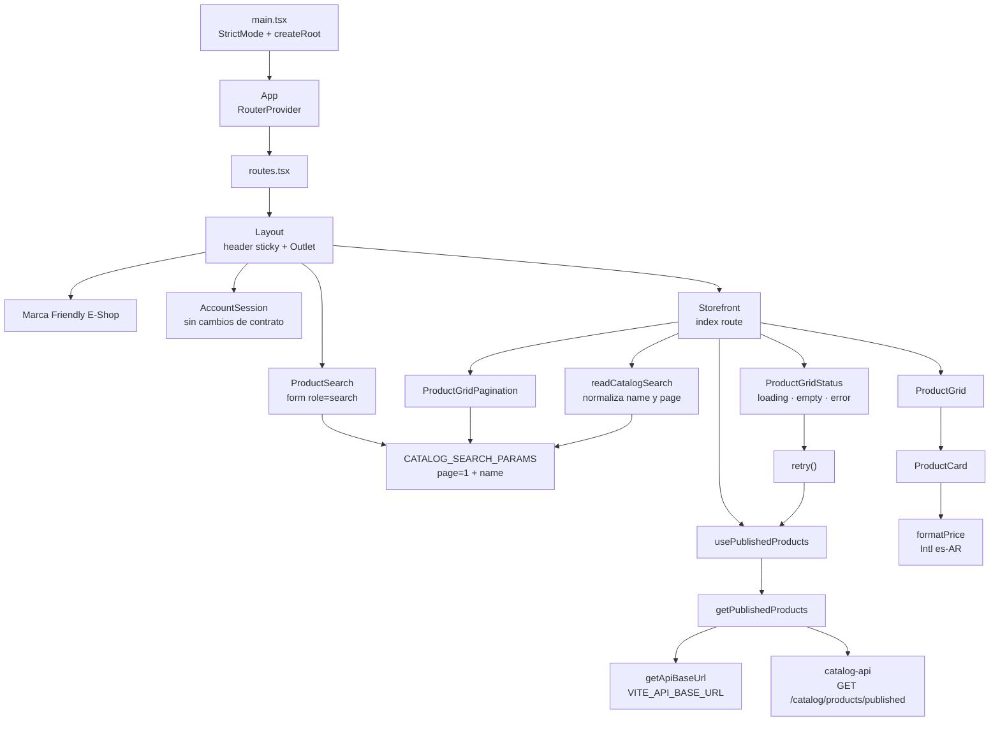
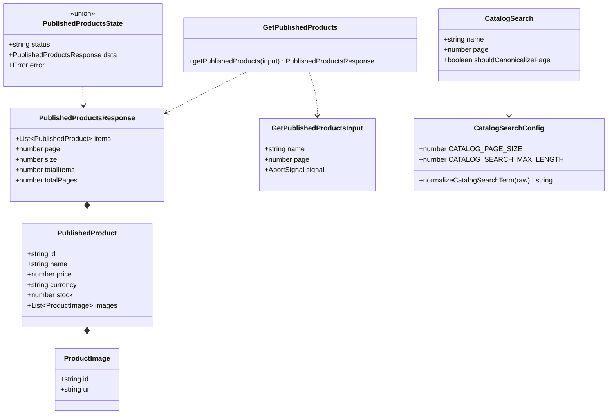
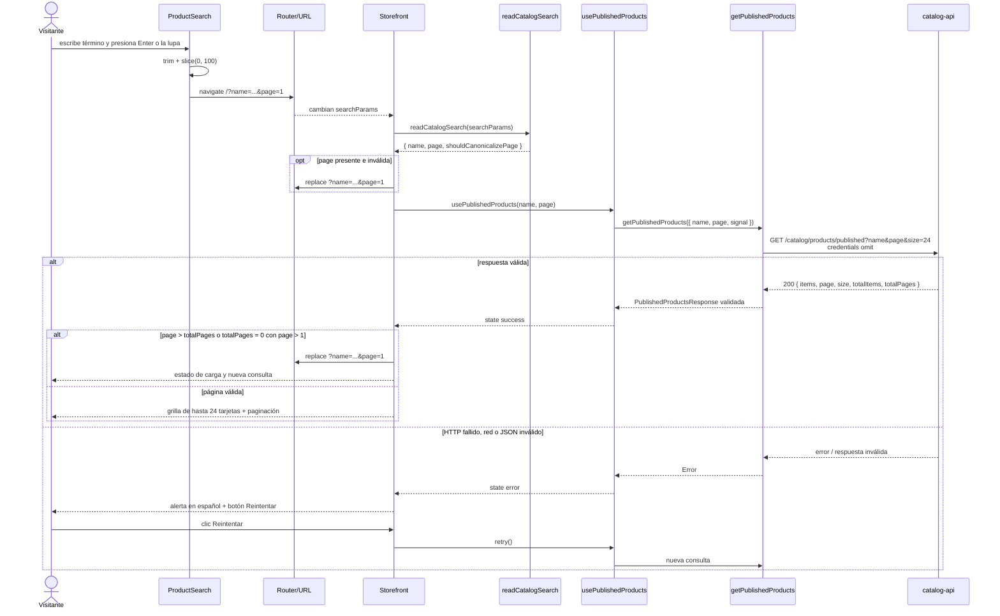
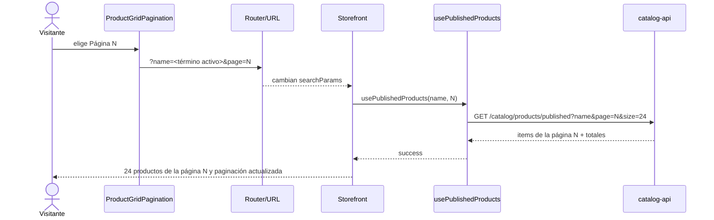
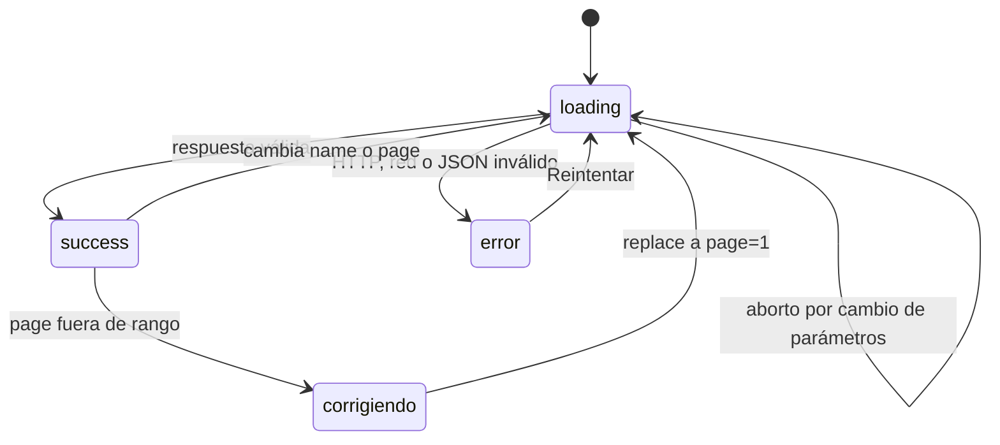

# UML 002 — Storefront con grilla de productos y buscador en el header

Diagramas del desarrollo planificado para `client-web`. Reflejan los archivos, contratos y flujos de `spec.md`, `plan.md` y `tasks.md`.

## Estructura de módulos

```text
src/app/
├── shared/
│   ├── api/catalog/
│   │   ├── constants.ts
│   │   ├── types.ts
│   │   └── get-published-products/
│   │       ├── get-published-products.ts
│   │       └── get-published-products.test.ts
│   └── config/
│       ├── api-base-url.ts
│       └── catalog-search.ts
└── views/
    ├── Layout/
    │   ├── Layout.tsx
    │   ├── Layout.test.tsx
    │   └── ProductSearch/
    │       ├── ProductSearch.tsx
    │       └── ProductSearch.test.tsx
    └── Storefront/
        ├── Storefront.tsx
        ├── Storefront.test.tsx
        ├── constants.ts
        ├── hooks/use-published-products/
        ├── lib/read-catalog-search/
        ├── lib/format-price/
        ├── ProductGrid/
        ├── ProductCard/
        ├── ProductGridPagination/
        └── ProductGridStatus/
```

## Composición de componentes



## Modelo de datos y contrato



- `price` se recibe como número JSON (`BigDecimal` serializado por `catalog-api`).
- `currency` se espera `ARS` o `USD`; `formatPrice` produce `$ 1.234,50` y `US$ 1.234,50`.
- `images` puede ser vacío: `ProductCard` muestra el marcador `ImageOff` con «Sin imagen».
- `totalPages = 0` con `totalItems = 0` representa catálogo o búsqueda sin resultados, no un error.

### Contrato HTTP

| Operación | Método | Path | Query | Credenciales |
| --- | --- | --- | --- | --- |
| Leer productos publicados | GET | `/catalog/products/published` | `name` opcional, `page` desde 1, `size=24` | `omit` |

El host se resuelve con `getApiBaseUrl()` a partir de `VITE_API_BASE_URL`. La tienda no envía cookies ni cabeceras de sesión.

## Flujo principal de búsqueda y carga



## Flujo de paginación



## Estados de la lectura



- `loading` muestra esqueletos con `role="status"` y mantiene el buscador del header usable.
- `success` con `totalItems > 0` muestra `ProductGrid` y `ProductGridPagination`.
- `success` con `totalItems = 0` muestra vacío por búsqueda si hay `name`, o catálogo vacío si no lo hay.
- `error` muestra `role="alert"` y el botón «Reintentar», que vuelve a `loading`.
- `corrigiendo` nunca renderiza la página ajustada por la API: la URL se reemplaza por `page=1` y se consulta de nuevo.

## Reglas de URL

| Caso | Resultado |
| --- | --- |
| `/` | `name = ''`, `page = 1`, sin reescritura. |
| `/?page=2` | Consulta página 2 sin filtro. |
| `/?name=zapatilla&page=3` | Consulta página 3 filtrada por «zapatilla». |
| `/?name=%20%20&page=1` | Se aplica sin filtro y `name` se omite al enviar. |
| `/?page=abc` | Se consulta `page=1` y la URL se reemplaza por `?page=1`. |
| `/?page=99` con `totalPages=3` | Se reemplaza la URL por `?page=1` y se consulta de nuevo. |
| Término de más de 100 caracteres | Se recorta a 100 antes de navegar y consultar. |
