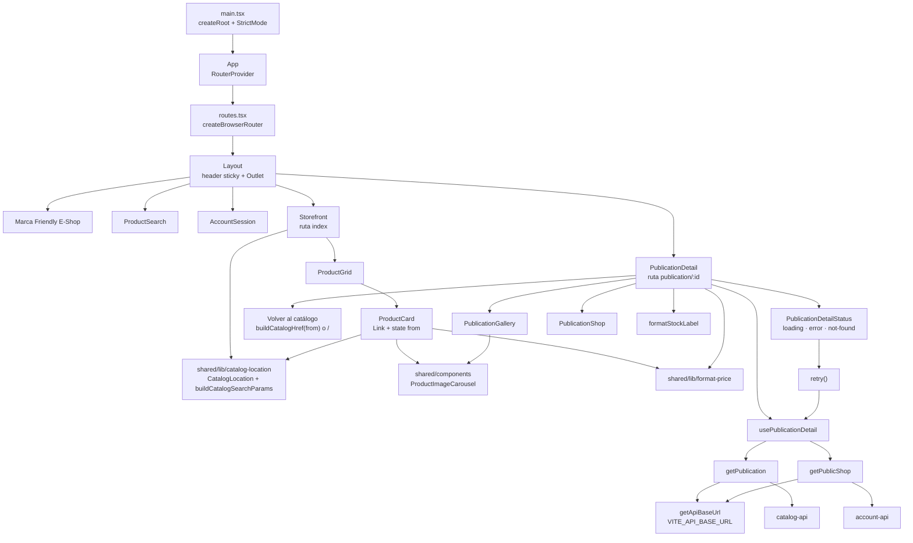
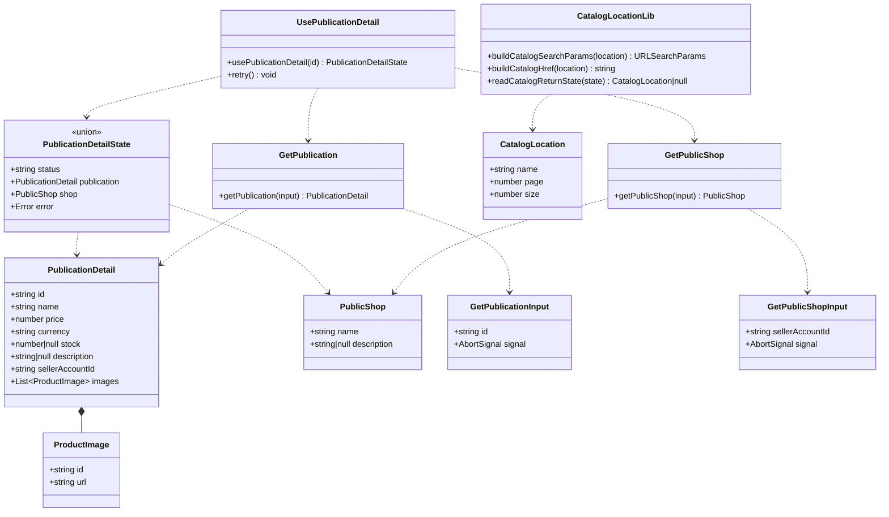
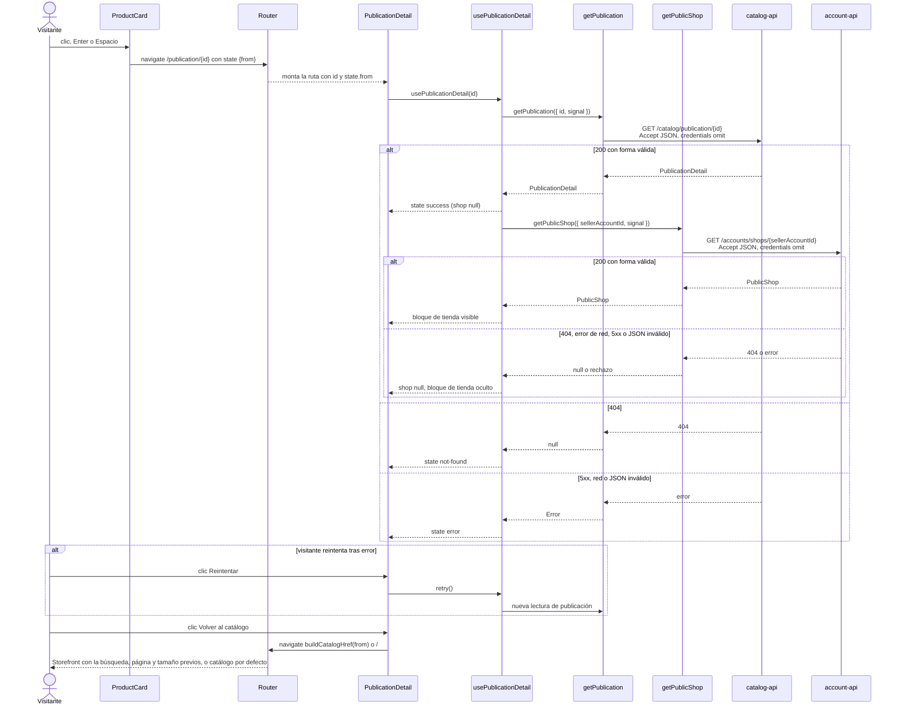
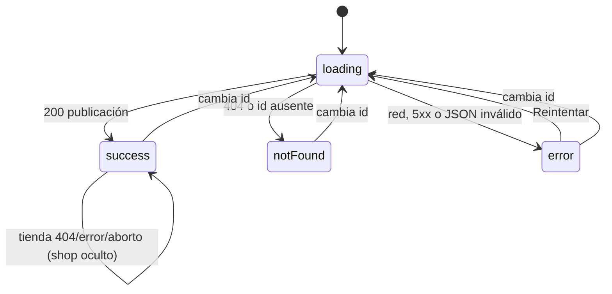

# UML 003 — Detalle público de publicación con descripción y tienda del vendedor

Diagramas del desarrollo planificado para `client-web`. Reflejan los archivos, contratos y flujos de `spec.md`, `plan.md` y `tasks.md`. Los identificadores de Mermaid conservan los nombres reales previstos en el código.

## Estructura de módulos

```text
src/app/
├── shared/
│   ├── api/
│   │   ├── catalog/
│   │   │   ├── constants.ts                 # CATALOG_PATHS.publication
│   │   │   ├── types.ts                     # PublicationDetail
│   │   │   ├── get-publications/            # existente
│   │   │   └── get-publication/
│   │   │       ├── get-publication.ts
│   │   │       └── get-publication.test.ts
│   │   └── account/
│   │       ├── constants.ts                 # ACCOUNT_PATHS.publicShop
│   │       ├── types.ts                     # PublicShop
│   │       └── get-public-shop/
│   │           ├── get-public-shop.ts
│   │           └── get-public-shop.test.ts
│   ├── components/
│   │   ├── AccountSession/                  # existente
│   │   └── ProductImageCarousel/            # promovido desde Storefront
│   │       ├── ProductImageCarousel.tsx
│   │       ├── ProductImageCarousel.test.tsx
│   │       └── constants.ts
│   └── lib/
│       ├── format-price/                    # promovido desde Storefront
│       │   ├── format-price.ts
│       │   └── format-price.test.ts
│       └── catalog-location/
│           ├── catalog-location.ts
│           └── catalog-location.test.ts
└── views/
    ├── Layout/Layout.tsx                    # header + AccountSession + Outlet
    ├── Storefront/
    │   ├── Storefront.tsx                   # pasa from y usa catalog-location
    │   ├── ProductGrid/ProductGrid.tsx      # prop from
    │   └── ProductCard/ProductCard.tsx      # Link + state from
    └── PublicationDetail/
        ├── PublicationDetail.tsx
        ├── PublicationDetail.test.tsx
        ├── constants.ts
        ├── hooks/use-publication-detail/
        │   ├── use-publication-detail.ts
        │   └── use-publication-detail.test.tsx
        ├── lib/format-stock-label/
        │   ├── format-stock-label.ts
        │   └── format-stock-label.test.ts
        └── components/
            ├── PublicationGallery/
            ├── PublicationShop/
            └── PublicationDetailStatus/
```

Rutas registradas en `src/app/routes.tsx`:

| Ruta | Vista | Layout |
| --- | --- | --- |
| `/` | `Storefront` | `Layout` |
| `/publication/:id` | `PublicationDetail` | `Layout` |

## Composición de componentes, hooks y clientes



## Modelo de datos y contrato



- `stock` es número o `null`; `null` significa ilimitado/no informado y produce «Disponible».
- `description` es `string` o `null`; la API limita su longitud a 1000 caracteres.
- `images` puede ser vacío: la galería muestra un marcador `ImageOff` decorativo.
- `sellerAccountId` es la referencia pública que alimenta la consulta de tienda.
- `PublicationDetailState.status` toma `loading`, `success`, `not-found` o `error`.

### Contrato HTTP

| Operación | Método | Path | Respuesta exitosa | No encontrado | Credenciales |
| --- | --- | --- | --- | --- | --- |
| Leer publicación pública | GET | `/catalog/publication/{id}` | `200 PublicationDetail` | `404` → `null` | `omit` |
| Leer tienda pública | GET | `/accounts/shops/{sellerAccountId}` | `200 PublicShop` | `404` → `null` | `omit` |

El host se resuelve con `getApiBaseUrl()` a partir de `VITE_API_BASE_URL`. Ambas lecturas envían `Accept: application/json`; no se envían cookies ni cabeceras de sesión. La tienda es opcional: su 404, error, JSON inválido o aborto no cambia el estado de éxito de la publicación, solo oculta el bloque de tienda.

Formas JSON citadas por el plan:

```json
{
  "id": "2f5b0f45-6a3e-4d2c-9a11-0b7e8f9c1d23",
  "name": "Zapatillas urbanas",
  "price": 45999.5,
  "currency": "ARS",
  "stock": 3,
  "description": "Suela de goma, talle 42, uso diario.",
  "sellerAccountId": "8f1c2b7a-3d4e-5f60-7a8b-9c0d1e2f3a4b",
  "images": [{ "id": "9a8b…", "url": "https://cdn.friendly-e-shop.test/zapatillas-1.webp" }]
}
```

```json
{
  "name": "Bazar del Sur",
  "description": "Artículos para el hogar."
}
```

## Flujo principal: tarjeta → detalle → APIs → vuelta



Observaciones del flujo:

1. La consulta de tienda depende del `sellerAccountId` de la publicación, por lo que es inherentemente secuencial; no bloquea el render de la publicación.
2. Un 404 de publicación detiene el flujo en `not-found`; no se consulta la tienda.
3. No hay intervalo, listener de visibilidad ni revalidación automática: si la publicación deja de ser visible mientras se mira, el contenido ya cargado permanece hasta recargar, reintentar o navegar.
4. El enlace de vuelta se calcula desde `state.from` validado; sin contexto válido, apunta a `/`.

## Estados de la vista



- `loading` muestra `role="status"` y mantiene visible «Volver al catálogo».
- `not-found` muestra el título y mensaje de publicación no encontrada.
- `error` muestra `role="alert"` y el botón «Reintentar», que vuelve a `loading`.
- `success` muestra el contenido; la tienda se agrega cuando resuelve y se oculta si no está disponible.
- La acción de vuelta está fuera del switch de estados y existe en todos.

## Reglas de navegación y retorno

| Entrada | `state.from` | Destino de «Volver al catálogo» |
| --- | --- | --- |
| Tarjeta desde `/?name=mesa&page=2&size=48` | `{ name: 'mesa', page: 2, size: 48 }` | `/?name=mesa&page=2&size=48` |
| Tarjeta desde catálogo por defecto | `{ name: '', page: 1, size: 24 }` | `/` |
| URL directa `/publication/{id}` | ausente | `/` |
| `state.from` con forma inválida o manipulada | inválido | `/` |

- La tarjeta construye el enlace a `/publication/${encodeURIComponent(product.id)}` y transporta el contexto en `state.from`.
- El detalle valida `state.from` con `readCatalogReturnState` antes de construir el href.
- No se usa `navigate(-1)` para no expulsar de la tienda a una URL directa.
- La tarjeta responde a ratón, Enter nativo del enlace y Espacio mediante `onKeyDown`; su nombre accesible es «Ver <nombre>».

## Trazabilidad resumida de RF en los diagramas

| RF | Elemento del diagrama |
| --- | --- |
| RF-1, RF-2, RF-3 | `ProductCard` como `Link` con `aria-label` y activación por Enter/Espacio. |
| RF-4, RF-5, RF-6 | `PublicationGallery` → `ProductImageCarousel`; marcador sin imágenes. |
| RF-7, RF-8, RF-9, RF-10, RF-11 | `PublicationDetail` con nombre, `formatPrice`, `formatStockLabel`, descripción o alternativa. |
| RF-12, RF-27, RF-28 | `getPublicShop` y `PublicationShop`; tienda opcional y aislada. |
| RF-13, RF-14 | Ruta `publication/:id` y `usePublicationDetail(id)`. |
| RF-15, RF-16 | 404 de `catalog-api` → `null` → `not-found`. |
| RF-17, RF-18, RF-19 | `loading`, `error` y `retry()` en el hook y el estado presentacional. |
| RF-20, RF-21, RF-25 | `BackLink` con `buildCatalogHref(from)` o `/`, presente en todos los estados. |
| RF-22, RF-23, RF-24 | Detalle informativo bajo `Layout`, sin compra y con clientes públicos. |
| RF-26 | El hook consulta únicamente el `id` recibido por la URL. |
| RF-29 | Sin polling ni revalidación automática; el estado `success` persiste hasta recargar, reintentar o navegar. |
